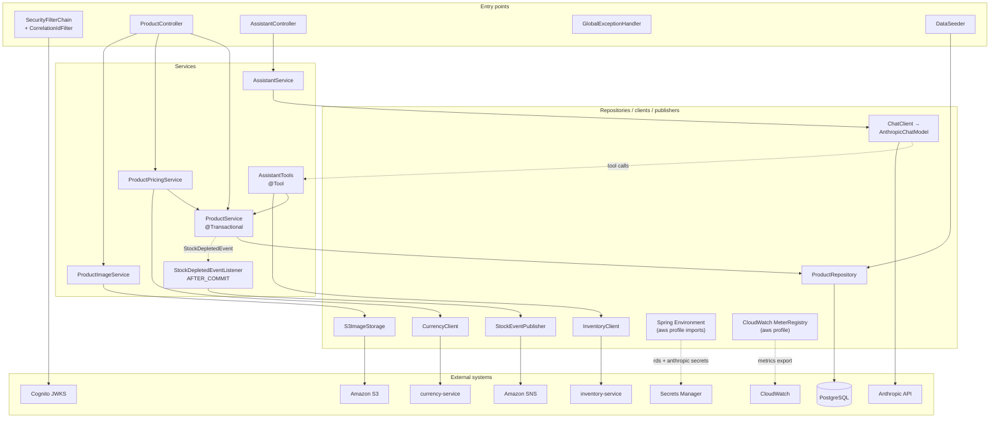

# product-catalog-mvc: Class Map

Every main class in `com.example.catalog`, how the classes depend on each other, and where this Spring MVC implementation deliberately differs from `product-catalog-reactive` (REACTIVE). For the REACTIVE inventory and its defects, see [gap-report.md](gap-report.md).

---

## 1. Classes

"Called by" lists the Spring-managed callers. It omits tests and the framework itself, except where the framework is the only caller.

### Entry points

| Class | Package | Stereotype / annotation | Responsibility | Injected dependencies | Called by |
|---|---|---|---|---|---|
| `ProductCatalogMvcApplication` | `com.example.catalog` | `@SpringBootApplication`, `@ConfigurationPropertiesScan` | Boot entry point; registers the `@ConfigurationProperties` records | none | JVM |
| `ProductController` | `controller` | `@RestController` `/api/v1/products` | The 9 product endpoints, with REACTIVE's paths, params and status codes. `POST /{id}/image` accepts multipart (`file` part) or a raw body. | `ProductService`, `ProductPricingService`, `ProductImageService` | HTTP clients |
| `AssistantController` | `controller` | `@RestController` `/api/v1/assistant` | `POST /chat`: plain-text prompt in, raw reply out (labeled `application/json`) | `AssistantService` | HTTP clients |
| `GlobalExceptionHandler` | `controller` | `@RestControllerAdvice` | Maps exceptions to responses: `ProductNotFoundException` → 404, `IllegalArgumentException` and `MethodArgumentNotValidException` → 400 (`ProblemDetail` with an `error` property), `DownstreamServiceException` → 503, `AssistantUnavailableException` → 500 `"Assistant unavailable: …"` | none | Spring MVC |
| `DataSeeder` | `config` | `@Configuration` (`CommandLineRunner` bean, `data.seed.enabled`) | Seeds REACTIVE's 3 products when the table is empty | `ProductRepository` | Spring Boot at startup |

### Services

| Class | Package | Stereotype / annotation | Responsibility | Injected dependencies | Called by |
|---|---|---|---|---|---|
| `ProductService` | `service` | `@Service`, `@Transactional(readOnly = true)`; writes use `@Transactional` | CRUD and search, entity ↔ record mapping, not-found handling. Publishes `StockDepletedEvent` when an update leaves stock at 0. Makes no remote calls. | `ProductRepository`, `ApplicationEventPublisher` | `ProductController`, `ProductPricingService`, `AssistantTools` |
| `ProductPricingService` | `service` | `@Service` (not transactional) | `/price`: looks up the product in `ProductService`'s transaction, then converts through currency-service outside any transaction. USD skips the remote call. | `ProductService`, `CurrencyClient` | `ProductController` |
| `ProductImageService` | `service` | `@Service` | Normalizes the upload (bytes plus content type, default `image/jpeg`). Turns an S3 `SdkException` into `DownstreamServiceException`. | `S3ImageStorage` | `ProductController` |
| `ProductMapper` | `service` | package-private final utility | Converts `ProductRequest` → `Product`, `Product` → `ProductResponse`, and `ProductResponse` + `CurrencyConversion` → `ProductWithPrice` | none | `ProductService`, `ProductPricingService` |
| `ProductNotFoundException` | `service` | `RuntimeException` | "Product not found: {id}" → 404 | none | thrown by `ProductService` |
| `DownstreamServiceException` | `service` | `RuntimeException` | A downstream failure surfaced to the caller → 503 | none | thrown by `ProductImageService` |
| `AssistantService` | `assistant` | `@Service` | Runs the `ChatClient` call, passing the caller's `Authorization` header through tool context; wraps any failure in `AssistantUnavailableException` | `ChatClient assistantChatClient` | `AssistantController` |
| `AssistantTools` | `assistant` | `@Component`, Spring AI `@Tool` ×2 | `getStock` and `getReorderEstimate`, with REACTIVE's names, descriptions and parameters. Checks the product exists, then calls inventory-service. Returns a plain message instead of throwing. | `ProductService`, `InventoryClient` | `ChatClient` (model tool calls) |
| `AssistantUnavailableException` | `assistant` | `RuntimeException` | Chat failure → 500 | none | thrown by `AssistantService` |
| `StockDepletedEventListener` | `messaging` | `@Component`, `@TransactionalEventListener(AFTER_COMMIT)` | Forwards `StockDepletedEvent` to SNS after commit. Logs and swallows SNS failures. | `StockEventPublisher` | Spring's transaction synchronization |

### Repositories, clients, publishers and storage

| Class | Package | Stereotype / annotation | Responsibility | Injected dependencies | Called by |
|---|---|---|---|---|---|
| `ProductRepository` | `repository` | `@Repository`, `JpaRepository<Product, Long>` | `findByCategory`, `findByStockQuantityGreaterThan`, `findByNameContainingIgnoreCase` (same derived queries as REACTIVE) | none | `ProductService`, `DataSeeder` |
| `CurrencyClient` | `client` | `@Component` | `GET /api/currencies/convert?from=USD&to=&amount=`. On error, timeout or an empty body, returns the USD amount labeled `USD` with `converted=false`. | `@Qualifier("currencyRestClient") RestClient` | `ProductPricingService` |
| `InventoryClient` | `client` | `@Component` | `GET /api/v1/inventory/{id}` and `…/{id}/reorder-estimate`, forwarding the caller's JWT. Returns `Optional.empty()` on any failure. | `@Qualifier("inventoryRestClient") RestClient` | `AssistantTools` |
| `StockEventPublisher` | `messaging` | `@Component` | Publishes REACTIVE's `STOCK_DEPLETED` message to SNS (subject `STOCK_DEPLETED`; body fields `event`, `productId`, `productName`, `timestamp`) | `SnsClient`, `AwsProperties`, `ObjectMapper` | `StockDepletedEventListener` |
| `S3ImageStorage` | `storage` | `@Component` | `PutObject` to `products/{id}/image.jpg` and returns `https://{bucket}.s3.{region}.amazonaws.com/{key}` | `S3Client`, `AwsProperties` | `ProductImageService` |

### Configuration

| Class | Package | Stereotype / annotation | Responsibility | Injected dependencies | Called by |
|---|---|---|---|---|---|
| `SecurityConfig` | `config` | `@Configuration`, `@EnableWebSecurity`, `@EnableConfigurationProperties(CorsProperties)` | Cognito JWT resource server with `cognito:groups` → `ROLE_*`. Public: OPTIONS, `/actuator/health`, `/actuator/info`. Stateless, CSRF off, bare 401 entry point, CORS source. | `HttpSecurity`, `CorsProperties` | Servlet filter chain |
| `CorrelationIdConfig` | `config` | `@Configuration` | Registers services-shared-lib's `CorrelationIdFilter` at `HIGHEST_PRECEDENCE` on `/*` | none | Servlet container |
| `RestClientConfig` | `config` | `@Configuration` | `currencyRestClient` (base URL, `X-API-Key`, JSON content type) and `inventoryRestClient`, each with connect 5 s / read 3 s | `RestClient.Builder`, properties | `CurrencyClient`, `InventoryClient` |
| `AnthropicModelConfig` | `config` | `@Configuration` | Custom `AnthropicApi` (`anthropic-api-key`) and `AnthropicChatModel` (`assistant.model`, 2048 max tokens, thinking disabled, no temperature/top_p/top_k). Autoconfig backs off. | properties | `AssistantConfig` |
| `AssistantConfig` | `config` | `@Configuration` | `assistantChatClient` with REACTIVE's system prompt and `AssistantTools` as default tools | `AnthropicChatModel`, `AssistantTools` | `AssistantService` |
| `AwsProperties` | `config` | `@ConfigurationProperties("aws")` record | `aws.region`, `aws.s3.bucket`, `aws.sns.stock-depleted-topic-arn` | none | `S3ImageStorage`, `StockEventPublisher` |
| `CorsProperties` | `config` | `@ConfigurationProperties("cors")` record | `cors.allowed-origins` | none | `SecurityConfig` |

### Data (`domain/`, `model/`)

| Class | Package | Stereotype / annotation | Responsibility | Used by |
|---|---|---|---|---|
| `Product` | `domain` | `@Entity @Table("products")`, Lombok | Maps REACTIVE's `products` table (identity `id`, `name`, `category`, `price` DECIMAL(10,2), `stock_quantity`) | `ProductRepository`, `ProductService`, `ProductMapper`, `DataSeeder` |
| `ProductRequest` | `model` | record, Bean Validation | POST/PUT body. Has no `id`. `@NotNull` on `name`, `category` and `price` (the NOT NULL columns). | `ProductController`, `ProductService` |
| `ProductResponse` | `model` | record | Same JSON as REACTIVE's `Product` | `ProductController`, `ProductService`, `ProductPricingService` |
| `ProductWithPrice` | `model` | record | REACTIVE's `/price` shape plus `converted` | `ProductController`, `ProductPricingService` |
| `CurrencyConversion` | `model` | record | Client result: `amount`, `currency`, `converted` | `CurrencyClient`, `ProductPricingService` |
| `CurrencyConversionResponse` | `model` | record | currency-service response body | `CurrencyClient` |
| `StockDepletedEvent` | `model` | record (application event) | `productId`, `productName` | `ProductService` → `StockDepletedEventListener` |
| `StockLevel`, `ReorderRecord` | `model` | records | inventory-service response bodies, same fields as REACTIVE | `InventoryClient`, `AssistantTools` |

---

## 2. Dependency graph

Solid arrows are calls or injections. Dotted arrows are indirect: the application event, the model's tool calls, and configuration and metrics plumbing. Nothing in the adapter layer calls back into a service.

---

## 3. Deliberate differences from REACTIVE

### API contract

1. **`converted` field on `/price`.** This is the one intended contract change. It's `true` only when currency-service actually converted the price. A USD request and the failure fallback both return `converted=false`.
2. **Currency fallback is labeled `USD`.** REACTIVE returned the USD amount labeled with the requested currency (for example `"EUR"`).
3. **Create ignores a caller-supplied `id`.** REACTIVE returned 400 `{"error":"ID must not be provided when creating a product"}`. `ProductRequest` has no id field, so Jackson ignores an `"id"` in the body, and the product is created with a database-assigned id (201).
4. **Image upload accepts two forms.** REACTIVE's raw-body contract (Content-Type defaulting to `image/jpeg`) still works, and `multipart/form-data` with a `file` part is added. The S3 key, URL and response are unchanged.
5. **Error bodies.**
   - 404s return a `ProblemDetail`; REACTIVE's had no body.
   - 400s are `ProblemDetail`s that keep REACTIVE's top-level `error` property.
   - A missing `name`, `category` or `price` is a 400 validation error, where REACTIVE failed with a 500 on the NOT NULL constraint.
   - A non-numeric `{id}` gets Spring MVC's 400 type-mismatch response; REACTIVE returned 500.
   - An S3 failure returns 503; REACTIVE returned a default 500.
6. **Assistant errors keep REACTIVE's contract.** They return 500 with `"Assistant unavailable: …"` labeled `application/json`, not a 503.

### Behavior

7. **SNS publish happens after commit.** `ProductService` raises `StockDepletedEvent`, and `StockDepletedEventListener` (`AFTER_COMMIT`) calls SNS. An SNS failure is logged and no longer turns a saved update into a 500. The event still fires on every update that leaves stock at 0, as before.
8. **The SNS body is serialized with Jackson.** It has the same fields, order and subject, but `productName` is now JSON-escaped and the whitespace is compact.
9. **Timeouts are real.** RestClient uses connect 5 s / read 3 s through the request factory. REACTIVE's 8 s response-timeout filter was dead.
10. **Inventory calls are timed and have a fallback.** A failure makes the tool tell the model "inventory data unavailable" instead of failing the chat request. The tools also check that the product exists in the catalog (via `ProductService`) before calling inventory-service.
11. **CORS.** REACTIVE's OPTIONS-200 filter (which sent no CORS headers) is replaced by a `CorsConfigurationSource` driven by `cors.allowed-origins`. Sessions are explicitly stateless.
12. **ERROR dispatches are permitted.** Boot's `/error` page shows the real status instead of a 401.
13. **Correlation IDs.** services-shared-lib's `CorrelationIdFilter` is registered ahead of security. REACTIVE didn't use the library at all.

### Configuration and infrastructure

14. **Profiles.** The default profile targets localhost PostgreSQL with keys from environment variables. The `aws` profile imports REACTIVE's Secrets Manager secrets, uses the RDS URL and enables CloudWatch export, which is off by default.
15. **Omitted from REACTIVE:**
    - The unused SQS client and queue URL
    - The `prometheus` actuator exposure
    - `ProductImageService.deleteImage`, which was never called
    - `SchemaInitializer` (`ddl-auto: validate` instead)
16. **AWS clients come from Spring Cloud AWS autoconfiguration.** The SDK version is managed by the 3.3.0 BOM, not pinned by hand. `spring.cloud.aws.region.static` is set from `aws.region`.
17. **Model name is a property.** `assistant.model` defaults to `claude-sonnet-5`; REACTIVE hard-coded it.
